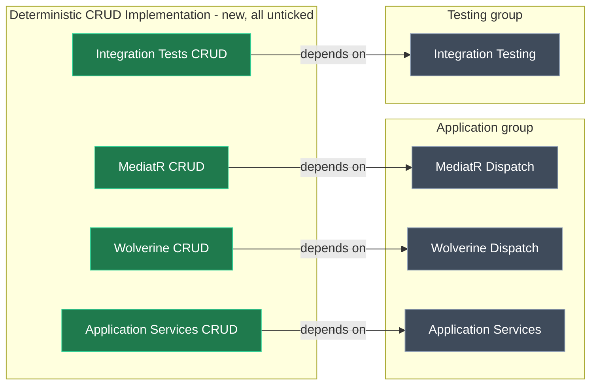

# Clean Architecture: opt-in "Deterministic CRUD Implementation" group

## Context

When an AI agent writes the handler and service bodies, the CRUD modules get in the way. They generate deterministic implementations for any operation that matches a CRUD convention. Today they're installed by default with the <ModelRef application="Intent.Modules.NET" name="Intent.ApplicationTemplate.AspNetCore6.0.CleanArchitecture" designer="App Templates" /> architecture template, because each one is an optional module inside the component it extends. I checked this against the live model:

| CRUD module | Lives inside component (today) | Module Settings today |
| --- | --- | --- |
| `Intent.Application.MediatR.CRUD` | Application / MediatR Dispatch | 7.2.2, Include By Default = true |
| `Intent.Application.CQRS.CRUD` | Application / Wolverine Dispatch | 1.0.0, Include By Default = true |
| `Intent.Application.ServiceImplementations.Conventions.CRUD` | Application / Application Services | 5.3.5, Include By Default = true |
| `Intent.AspNetCore.IntegrationTests.CRUD` | Testing / Integration Testing | 1.0.21, not included by default |
| `Intent.Application.MediatR.CRUD.Eventing` | (not in the template) | pulled in by interop |
| `Intent.Application.ServiceImplementations.CRUD.Eventing` | (not in the template) | pulled in by interop |

**Example, after the change:** a user creates a Clean Architecture app and accepts the defaults. MediatR Dispatch and Application Services are installed, but no CRUD module. A new **Deterministic CRUD Implementation** group shows MediatR CRUD, Wolverine CRUD, Application Services CRUD and Integration Tests CRUD, all unticked. Ticking MediatR CRUD installs `Intent.Application.MediatR.CRUD`. If MassTransit is also selected, `Intent.Application.MediatR.CRUD.Eventing` follows automatically.

## Approach

Move each CRUD module out of its host component into its own new component in a new group. Each new component carries a **Dependency** on the component it extends, and **Include by Default** is `false`.

<Callout id="no-show-hide" tone="warning" title="No conditional show/hide, so Dependencies stand in for it">

The App Templates designer can't show a component only when another is selected. `Component Settings` only offers **Dependencies** and **Incompatibilities**, and `Module Settings` has no condition. The closest available behaviour is a Dependency: MediatR CRUD can't be selected without MediatR Dispatch.

We need one component per CRUD module because a single "CRUD" component would install all four modules together. That would pull MediatR (a dependency of `MediatR.CRUD`) into a Wolverine app, and the reverse.

</Callout>

<Callout id="eventing-interop" tone="info" title="The two Eventing CRUD modules need no template change">

The messaging modules pull them in through interoperability rules. For example, `Intent.Eventing.MassTransit` detects `Intent.Application.MediatR.CRUD` and then installs `Intent.Application.MediatR.CRUD.Eventing`. If the base CRUD modules aren't installed, the Eventing variants aren't either.

</Callout>

_Green: new components. Grey: existing components, which lose their CRUD module._

## Model changes

All changes are in the **App Templates** designer of the **Intent.Modules.NET** application, package `Intent.ApplicationTemplate.AspNetCore6.0.CleanArchitecture`. The designer has no module rules.

<ModelChanges id="changes" caption="Proposed App Templates changes" changes={[
  { element: "Deterministic CRUD Implementation", designer: "App Templates", change: "added", note: "Component Group. Component Group Settings: Selection Mode = Allow Multiple. Placed after the Testing group." },
  { element: "MediatR CRUD", designer: "App Templates", change: "added", note: "Component holding the moved Component Module `Intent.Application.MediatR.CRUD` (7.2.2)",
    fields: [{ label: "Include by Default", after: "false" }, { label: "Dependencies", after: "MediatR Dispatch" }, { label: "Icon", after: "copied from MediatR Dispatch" }] },
  { element: "Wolverine CRUD", designer: "App Templates", change: "added", note: "Component holding the moved `Intent.Application.CQRS.CRUD` (1.0.0)",
    fields: [{ label: "Include by Default", after: "false" }, { label: "Dependencies", after: "Wolverine Dispatch" }, { label: "Icon", after: "copied from Wolverine Dispatch" }] },
  { element: "Application Services CRUD", designer: "App Templates", change: "added", note: "Component holding the moved `Intent.Application.ServiceImplementations.Conventions.CRUD` (5.3.5)",
    fields: [{ label: "Include by Default", after: "false" }, { label: "Dependencies", after: "Application Services" }, { label: "Icon", after: "copied from Application Services" }] },
  { element: "Integration Tests CRUD", designer: "App Templates", change: "added", note: "Component holding the moved `Intent.AspNetCore.IntegrationTests.CRUD` (1.0.21)",
    fields: [{ label: "Include by Default", after: "false" }, { label: "Dependencies", after: "Integration Testing" }, { label: "Icon", after: "copied from Integration Testing" }] },
  { element: "Moved CRUD Component Modules (all four)", designer: "App Templates", change: "modified", note: "Re-parented, Version and Include Assets unchanged",
    fields: [{ label: "Is Required", before: "false", after: "true" }, { label: "Include By Default", before: "true (false for IntegrationTests.CRUD)", after: "true" }] },
  { element: "Intent.ApplicationTemplate.AspNetCore6.0.CleanArchitecture", designer: "App Templates", change: "modified", fields: [{ label: "Application Template Settings: Version", before: "5.2.24-pre.0", after: "5.2.24-pre.1" }] },
]} />

- Each new component gets a short **Description** saying it generates deterministic CRUD implementations for the component it extends, plus the **Documentation Url** of the CRUD module it installs. Required License = None, matching its siblings.
- Inside its own component, each CRUD module is the only module, so it becomes **Is Required = true** and **Include By Default = true**. The component tick is now the only switch.
- Leave the **Minimum Dependency Versions** entries for the CRUD modules as they are. They only set version floors and don't install anything.

<Callout id="move-not-recreate" tone="info" title="Move with setParent, so every ID survives">

The scripting API supports `el.setParent(...)`, so each Component Module is moved rather than recreated. The four host components keep their IDs, which other components reference through Dependencies and Incompatibilities (MediatR Dispatch and Wolverine Dispatch are mutually incompatible). The new components' Dependencies use the host components' real IDs, read in the same script.

</Callout>

<Callout id="version" tone="warning" title="Version bump: 5.2.24-pre.1, not the 5.2.21-pre.0 in the draft">

The draft assumed the template was at 5.2.20. It is now `5.2.24-pre.0` on this branch, and that version is already on `origin/prerelease` and `origin/development` (`origin/master` has `5.2.23`). Bumping to `5.2.24-pre.1` gives a distinct prerelease package without skipping a release number. This is cheap to change if the team prefers `5.2.25-pre.0`.

</Callout>

## Steps

1. **Create the group and components, and move the modules.** In one `run_designer_script` against App Templates:
   - add the `Deterministic CRUD Implementation` Component Group with Selection Mode = Allow Multiple, positioned after Testing;
   - add its four Components and set Component Settings: Include by Default false, Dependencies (host component ID), Icon (copied verbatim from the host's Icon value), Description, Documentation Url and Required License;
   - `setParent` each CRUD Component Module under its new component and set Is Required = true and Include By Default = true;
   - set the template Version to `5.2.24-pre.1`.

   Fix any `errors[]` in a follow-up script.
2. **Run the Software Factory** for **Intent.Modules.NET** so <FileRef path="Modules/Intent.Modules.NET/Intent.ApplicationTemplate.AspNetCore6.0.CleanArchitecture/metadata.iatspec" /> is regenerated. Inspect the diff before applying.

## Critical files / elements

- App Templates designer, package `Intent.ApplicationTemplate.AspNetCore6.0.CleanArchitecture`: the Application and Testing groups, and the new group.
- `metadata.iatspec` (above) is generated output only. Don't edit it by hand.

## Verification

- The designer script reports no validation errors.
- After the Software Factory run, `metadata.iatspec` has a `Deterministic CRUD Implementation` group with four components. Each one is `included="false"`, has one `dependency`, and holds one required module. MediatR Dispatch, Wolverine Dispatch, Application Services and Integration Testing no longer list a CRUD module, and the version is `5.2.24-pre.1`.
- Manual smoke test (optional, needs the template packaged locally): create a Clean Architecture app with defaults and confirm no `*.CRUD` module is installed. Then create one with MediatR CRUD ticked and MassTransit selected, and confirm `Intent.Application.MediatR.CRUD` and `Intent.Application.MediatR.CRUD.Eventing` are both installed.

## Open questions resolved

- **Q:** How should the group be shaped? **A:** One component per CRUD module, each with a Dependency on the component it extends. Conditional show/hide isn't supported by the template format.
- **Q:** Which templates? **A:** Clean Architecture only. Dapr, Blazor Server, Azure Functions, AWS Lambda and Modular Monolith Module are deferred.
